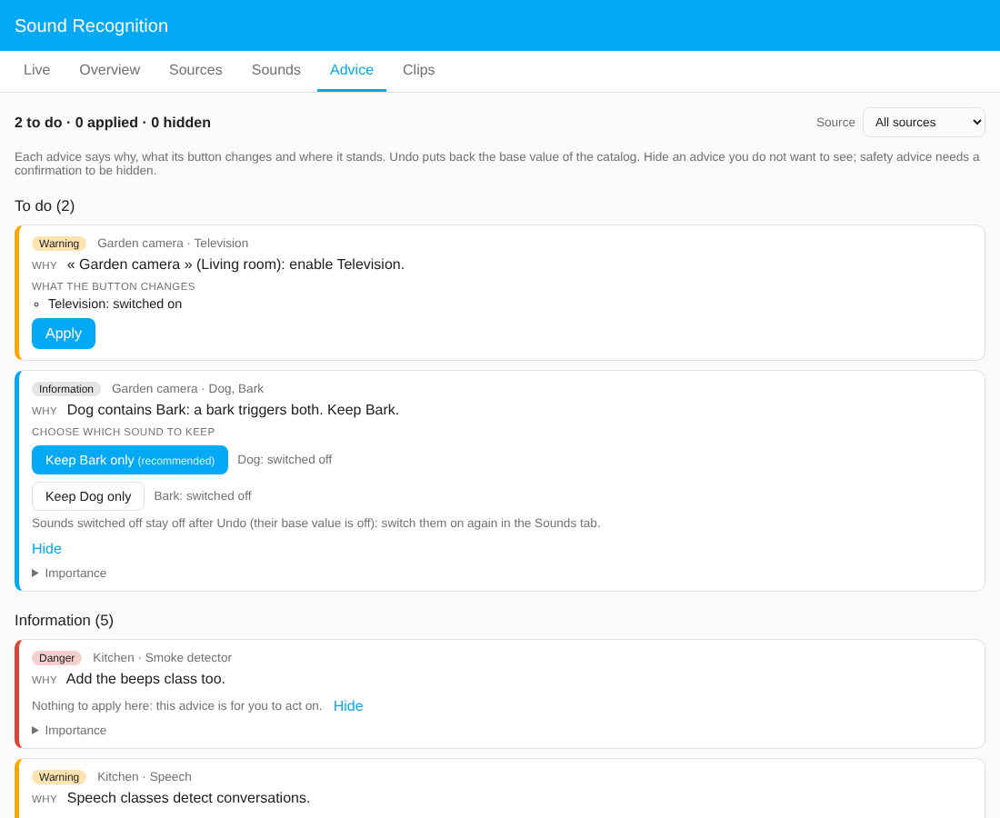

# The Advice tab

Sound Recognition looks at your settings and tells you when something is risky, redundant or missing: a smoke alarm that is switched off at night, two sounds that fire together, a sound that looks like another one. These are the **advice items**. They never change anything on their own.

## Reading a card

Each card says three things:

- **Why**: what the problem is, in plain words, and for which source and sounds.
- **What the button changes**: the exact settings that will be modified.
- **Where it stands**: to do, information, applied or hidden.

The colour and badge give the importance: *Information*, *Warning* or *Danger*.

## The four sections

| Section | What is in it |
|---|---|
| **To do** | Advice with a button that fixes it. |
| **Information** | Advice that is for you to act on (nothing the button could safely decide). |
| **Applied** | What you have already applied, with what it changed and when. |
| **Hidden** | Advice you chose not to see. It stays listed so you can show it again. |

The **Source** filter at the top shows one source or all of them.

## Buttons

- **Apply** changes the listed settings. You can also apply from the Home Assistant *Repairs* page, which shows the list of changes before you confirm.
- **Keep X only**: when two sounds overlap (for example *Dog* and *Bark*), you choose which one to keep. The recommended one comes first.
- **Undo**: puts an applied advice back to the **base value of the catalog** (the value before the advice). A sound that the advice switched off is not switched back on, because its base value is off; the card reminds you, and you can switch it on again in the Sounds tab.
- **Hide / Show again**: hides an advice you do not want to see. Advice about safety sounds (fire, baby, glass, screams) asks for a confirmation first.
- **Importance**: changes the level of an advice type, for one source or for all sources.

Applying advice never loops: an advice you applied does not come back because of its own change (this is checked by a test over every rule).

## A source that listens to nothing

A source that is on but has **no sound enabled** detects nothing while it still uses the machine. Sound Recognition says so (rule `listens_to_nothing`, level *warning*):

- in the **Advice** tab, and in Home Assistant **Repairs** so that the administrators see it;
- it waits **one hour after the service first sees the source**, so that a new source can be set up without a warning in the meantime (the check made when you save a source is not delayed);
- if the kind of place is known (set on the source, or deduced from Home Structure and the area), the message names the **sounds proposed for that kind of room**, taken from its preset, and **Apply** (in the panel or with *Fix* in Repairs, after a confirmation) adds the preset to the source. If you prefer to choose, pick the sounds one by one in the *Sounds* tab, starting from the proposed list;
- if the kind of place is unknown, the message says so and nothing is guessed: choose the type of place in the source form, or the sounds yourself;
- nothing is ever enabled without you, and the advice disappears as soon as a sound is on. For a source that is off on purpose, **hide** it like any other advice (*Display*), for that source only if you wish.

## Where the advice comes from

The advice is written in the language-neutral **catalog** (`catalog/catalog.yaml`), not in the code, so that it can be reviewed and translated:

- *Rules* about sounds that are close to each other, risky combinations or sounds that need a context.
- A `fix` that says what the button changes (`enable`, `disable`, or `set` of a threshold, minimum duration, cooldown or clip retention), or a `choose` for the "keep one" buttons.
- Automatic checks on your own settings: a low threshold on a sound with many false alarms, a schedule gap on a safety sound, a missing context sound, clips of a sound that must not be stored.

Contributions are welcome: see the comment at the top of `catalog/catalog.yaml` for the syntax, and run `python3 tools/validate.py` to check a change.
